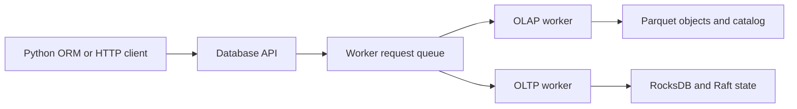

Both database engines accept the same table operations. The engine compiled into `nabedra-db` determines how the worker executes requests and stores data. Nabedra Events runs separately and can write to OLAP through a subscription sink.

## From request to result

1. The API authenticates and bounds the request, then submits it to the worker queue. A synchronous client waits on the result. A receipt client can disconnect after acceptance, then poll.
2. Ready workers retain admitted records in memory. Compute threads and working memory have separate ceilings from queue capacity. A saturated worker can hold accepted work until its tasks are eligible.
3. A read pins one committed view for that operation. In OLAP, the coordinator combines partition results using global ordering, limit and projection. In OLTP, timestamps and visibility rules govern indexed reads and scans.
4. A mutation publishes a complete effect with a durable decision. OLAP conditionally writes its catalog after uploading candidate files. OLTP prepares affected state and records the outcome under its transaction protocol.
5. A receipt can recover a known mutation decision after a lost response or a worker run change. When all queue copies disappear, unfinished work loses its in-memory execution state.

## Storage and deployment boundaries

| Component | Durable state | Failure boundary |
| --- | --- | --- |
| OLAP | Catalog, immutable Parquet files and durable request decisions | The catalog's conditional write fences old owners and publishes an atomic reference set. |
| OLTP | RocksDB-backed data and authority state | A standalone worker runs at RF1. Distributed configurations use separate authority and data groups, with placement and quorum requirements. |
| Events | Topic metadata, partition logs and subscription checkpoints | Broker placement determines each Raft group's replica set. Its state and credentials are independent of the database. |

See [OLAP storage](/server/olap), [OLTP transactions](/architecture/oltp-transactions), [worker scheduling](/server/worker-runtime), and [Events placement](/events/broker#inspect-and-change-placement) for the individual paths.
