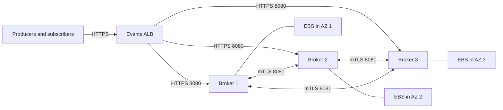

The Terraform configuration provisions an HTTPS Application Load Balancer and
one private EC2 instance and separately managed encrypted EBS volume per broker
ID. Each broker's private DNS name is stable across host replacements. Start
with three metadata voters in distinct Availability Zones and create
production topics with replication factor 3. The OLAP cluster and sink have
their own hosts, storage and credentials.



## Provision the brokers

[Download the source archive](/guides/installation#download-the-source-archive)
and copy the Terraform module at `$nabedra_source/server/events/deploy/aws`
to a permanent project directory. Run Terraform 1.7.0 or newer there so it can
retain local state after you remove the temporary archive directory.

1. Supply an existing VPC, at least three private broker subnets, an ALB subnet
   in each broker zone, a VPC-associated private Route 53 zone, and a client
   hostname with a matching regional ACM certificate. The private hosts need
   network access to their regional S3 artifacts, Secrets Manager and SSM. Use
   SSM for operator sessions. The instance security group allows only the ALB
   to reach TCP 8080 and other brokers to reach TCP 8081.
2. Supply an EC2 Nitro AMI compatible with the broker binary. Use a Linux AMI
   with cloud-init, systemd, AWS CLI v2, SSM Agent, Bash, jq, util-linux, XFS
   tools and the C++ runtime. Build the binary from the same archive on a
   compatible Linux builder with Rust 1.94.1 or newer, Cargo, `pkg-config`, and
   the [RocksDB build prerequisites](/guides/installation#install-a-preview-server).

   ```sh
   cargo build --locked --release --manifest-path "$nabedra_source/server/events/Cargo.toml" \
     --bin nabedra-events
   ```

   Publish `server/events/target/release/nabedra-events` from the extracted
   archive to an immutable private S3 artifact key and record its SHA-256.
3. Create one Secrets Manager secret per broker. Use the same cluster UUID,
   grant and session signing rings, peer CA trust and peer token throughout
   the cluster. Each broker gets its own private peer credential. Its server
   certificate must cover `broker-<id>.<peer-zone>` as a DNS SAN. Issue its
   outgoing client certificate under a trusted peer CA with client-auth usage.
4. Copy the module's `terraform.tfvars.example` to `terraform.tfvars` and
   replace the sample settings. Mark `format_blank_volume=true` only for
   intended blank disks. Give the lowest metadata voter the genesis flag in
   its secret for the first deployment. Keep that flag false everywhere else.
5. Run `terraform init`, review `terraform plan`, and apply the reviewed plan.
   Confirm the three targets are healthy and inspect the committed metadata
   voter list through `/v1/admin/groups/metadata`. Clear the genesis flag and
   formatting flags after bootstrap. Restart the genesis broker with the
   updated secret once its two peers are healthy.

Cloud-init installs the service and records the expected EBS volume ID.
Every startup checks the disk serial, mounts its filesystem at the broker
data directory, verifies the artifact checksum, and fetches the current
secret. It formats an unsigned blank disk only if requested and clears the
local format flag after mounting. The non-root broker opens RocksDB only
after its exact data directory is mounted. EBS attachments stop the old host
before detaching the volume. Terraform protects the registered data disks
from destruction while they are managed by this configuration.
[Stable EBS device identification](https://docs.aws.amazon.com/ebs/latest/userguide/identify-nvme-ebs-device.html) · [Terraform volume attachment options](https://registry.terraform.io/providers/hashicorp/aws/latest/docs/resources/volume_attachment)

The ALB presents the configured ACM certificate to clients and encrypts
the connection to the HTTPS target. Broker ingress is limited to
the ALB's security group. Peer traffic uses mutual TLS with private CA trust,
plus cluster credential verification at the HTTP layer. Keep peer DNS names
and the cluster UUID stable during an in-place replacement.
[ALB HTTPS target connections](https://docs.aws.amazon.com/elasticloadbalancing/latest/application/load-balancer-target-groups.html)

### Secret shape

Supply a JSON object with these fields. PEM strings include their line breaks.

| Field | Contents |
| --- | --- |
| `peer_token` | Shared random cluster token, 32 to 256 printable ASCII characters |
| `keyring` | `cluster_id` and independent `grant` and `session` signing rings |
| `initialize_new_cluster` | Boolean, true only for an intentional first genesis |
| `public_cert`, `public_key` | Server PEM chain and key for the broker's ALB target listener |
| `peer_ca` | PEM root chain used to verify private client and server connections |
| `peer_cert`, `peer_key` | Broker-specific peer listener PEM server chain and key |
| `peer_identity` | PEM client chain and private key used to dial peers |

Each signing ring is `{"active":"v1","keys":[{"id":"v1","secret_hex":"…","accept_until_ms":…}]}`.
Provide a full, random 64-character hexadecimal secret and a future
expiration as epoch milliseconds. Keep secret payloads outside Terraform
inputs. The broker role only gets its specific secret and binary object.
The separate backup policy is available as `backup_operator_policy_arn`
for attachment to an authorized operator role.

## Scale and replace brokers

For a new broker, allocate a new ID, its own EBS volume and certificate,
and the bootstrap config for the existing cluster. Keep its genesis flag
false. Register it with `add_broker` if the live catalog lacks that ID. Use
`rebalance` or select placement with `move_partition` and inspect the
published voters and applied indexes. Move metadata voters separately
with `move_metadata`. Partitions continue to use their existing IDs.

For a planned retirement, wait for `drain` to complete and verify each
group's replacement membership has committed. Then set
`provision_instance=false` for the retired ID and apply. Keep its map entry
to retain the data volume.

For a failed host with usable EBS, verify the previous host is stopped and
fenced. Replace that broker's EC2 instance in its existing Availability Zone
and reattach its recorded volume. The initial metadata and topic data
reopen from the same disk. Verify its ready response and Raft applied indexes
before the next maintenance action. Never force-detach a live disk.

For a lost disk or zone, keep the surviving quorum running. Add a broker
with a new ID and fresh volume in the recovered or replacement zone. Move
the affected metadata and partition replicas to the added broker while
the surviving quorum is available. Wait for the learner to catch up and
confirm the committed replacement covers three zones again. Remove the
unavailable broker from traffic after its groups have replacements.
If an affected group has lost quorum, attempt to recover its original disks
from their existing hosts or volumes. If that fails, restore a verified
backup into a fresh cluster. Restarting an empty group cannot recover its
previous committed history.

## Back up and restore

Export while metadata membership is stable and the groups have quorum.
Run the export from a broker or authorized private host using the broker
binary and a config with private peer credentials. Allocate scratch space
for both broker snapshot transfer and the export bundle. The CLI compares
layout before and after export and records a committed cut per group. The
cuts represent partition histories at independently applied indexes.

```sh
bundle=/srv/events-backup/orders-2026-11-17T2000
config=/etc/nabedra-events/current/broker.json
nabedra-events backup --config "$config" --output "$bundle"
destination="s3://$backup_bucket/$backup_prefix/${bundle##*/}"
aws s3 cp --recursive "$bundle/" "$destination/" --exclude manifest.json \
  --sse aws:kms --sse-kms-key-id "$backup_kms_key_arn"
aws s3 cp "$bundle/manifest.json" "$destination/manifest.json" \
  --sse aws:kms --sse-kms-key-id "$backup_kms_key_arn"
```

Use a unique prefix per run and upload the manifest after the images. Use a
versioned encrypted bucket and retain backup policy separately from event
retention. Monitor backup age and record the partition cuts and export
duration. Restore rehearsals cover download and checksum verification,
provisioning and mount time, election, and visibility of expected events and
checkpoints.

For recovery, download the complete bundle. Prepare an offline target with
empty mounted disks, a new cluster UUID and keys, and the broker IDs,
placements and zones recorded in the manifest. Original broker IDs, zones
and metadata voters must match the manifest. Private DNS can point to the
new hosts. Set `start_broker=false` for each new EC2 instance so cloud-init
mounts and configures its disk without starting the broker. Use a separate client hostname until recovery is verified. Keep the
target genesis flag false and run on every target broker.

```sh
nabedra-events restore --config "$config" --backup "$downloaded_bundle"
```

Run restore as the same host user that owns the broker disk. Enable and
start `nabedra-events.service` on all restored targets, confirm every group is healthy and replay representative
checkpoint ranges against the expected cuts before pointing client DNS at
the target. Use newly issued credentials. Record realized RPO from the cuts
and RTO from the start of recovery through verified client availability.

## Rotate credentials and upgrade

Add the next grant or session signing key to every broker's accepted keys
while the original key stays active. Roll that configuration across brokers
one at a time. Switch the active ID in a second roll and keep the prior key
usable until grants and deliveries signed by it have expired, including
clock skew. Reissue scoped grants before their expiration. Rotate peer
certificates in the same order, by trusting both CAs first, rolling the new
broker and client certificates, then removing the old CA. The shared peer
token is single-valued. Rotating it requires a coordinated service restart.
Schedule that restart with current backups and stop producer admission
until broker quorum returns.

For a binary upgrade, verify mixed-version wire and disk behavior on a
separate cluster, including snapshot transfer and retained-volume reopen.
Back up before the roll. Update the artifact key and checksum for one
broker at a time and explicitly replace that EC2 instance, or stage the
verified binary on that host using its operator session. User data changes
alone leave running hosts in place. Keep the broker's volume and ID, then
wait for its target health, leader elections and applied indexes to settle
before replacing the next. If the new version writes an incompatible disk
format, restore the prior binary and its compatible backup to a fresh target.

## Monitor service and size disks

Probe `/readyz` and sample operator status for individual groups and
partitions. The ALB can still serve healthy routes when a partition lacks
quorum. Collect publisher and subscriber latency, overload and unknown
outcomes, per-broker request load, CPU and memory, leader and follower
applied indexes, partition tail minus subscription checkpoint, failed
backups and volume headroom. Track clock offset across brokers. Use ALB
latency and target health alongside EC2 and EBS I/O, networking and disk
telemetry. Track inter-zone transfers when sizing RF3. Report performance
and recovery targets per workload and verify them under the intended
retention, replica count and failure profile.

Estimate retained encoded bytes per partition from payload distribution,
event rate and retention time. Multiply by the assigned replica count.
Measure additional space and I/O for RocksDB compaction, log segments,
snapshot staging and learner catch-up. Leave enough headroom for a
replacement to catch up while producers continue. Add partitions for
independently ordered keys when a single partition leader saturates.
