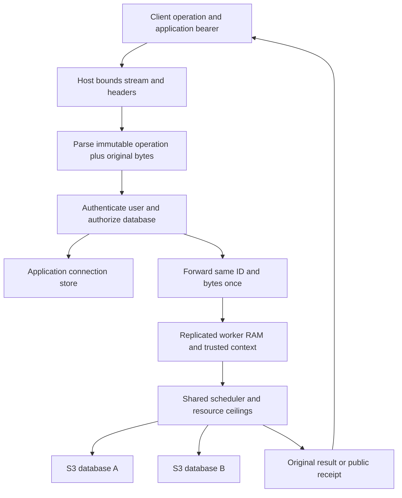

Use Python 3.11 or newer. In your application's Python environment, install the latest gateway from PyPI.

```sh
python -m pip install --upgrade 'nabedra[gateway]'
```

Use `'nabedra[gateway,aws]'` if you need Boto3 credential discovery.

## Authorize a connection

The client uses its existing ORM against the application's endpoint:

```python
from nabedra import Database

db = Database(url='https://app.example.com/nabedra', token=application_token, database='authorized-selector')
```

`database` is optional untrusted input. The application authenticates the user and authorizes that selector. The client receives no AWS credentials. The server integration accepts plain HTTP values:

```python
from nabedra.gateway import Gateway, GatewayContext, S3

gateway = Gateway(cluster_url='https://compute.internal',
                  token=private_compute_token, mount_path='/nabedra')

@gateway.middleware
async def authorize(ctx: GatewayContext):
    user = await authenticate(ctx.headers.get('authorization'))
    if user is None:
        ctx.reject('unauthorized', 'Authentication required')
    connection = await authorized_connection(user.id, ctx.database)
    ctx.principal = user.id
    ctx.storage = S3(connection.bucket, region=connection.region,
                     prefix=connection.prefix, credentials=connection.credentials)

async def endpoint(method, target, header_pairs, raw_body):
    return await gateway.handle_async(method=method, path=target,
        headers=tuple(header_pairs), body=raw_body)
```

`authenticate` and `authorized_connection` are application-owned functions. The server routing code maps the returned `HTTPResponse.status`, `.headers` and `.body` directly to its response. It does not inspect operation fields or reconstruct the operation with ORM methods. `target` includes any query string and is never a full URL. Supply original duplicate header pairs.

## Integrate your HTTP host

The host must stop collecting its input stream at 8 MiB, regardless of declared length. It must also bound headers, concurrent connections and read deadlines before allocating bodies. Gateway's post-read check cannot recover host memory already allocated. The finite loopback fixture in `scripts/gateway_host_fixture.py` demonstrates incremental collection and rejects oversized chunk lengths before reading their data; it is test infrastructure, not a production HTTP server.

Gateway bounds operation/response bodies at 8 MiB, decoded storage context at 16 KiB, its encoded header at 24 KiB and total headers at 32 KiB. Configure reverse proxies with matching caps. The gateway forwards database operations and receipts. Use a directly reachable OLAP API for [batch streaming](/python/streaming). Each receipt access runs middleware again. The helper removes the mount prefix, preserves the exact original operation bytes/ID and submits once. It consumes the application bearer and database selector, adds trusted storage context and compute authentication, and drops arbitrary client headers/cookies. Never pass external identity or storage headers through.

Use `async with gateway` for its application worker lifetime, or `with gateway` for synchronous hosts; explicit `aclose()`/`close()` are available. `handle()` accepts synchronous middleware. `handle_async()` accepts async middleware and runs synchronous callbacks in bounded threads. Python cannot kill a running synchronous callback: timeouts stop waiting but keep its capacity charged until it returns. Give middleware and credential providers their own finite I/O deadlines. Shutdown cannot guarantee interpreter exit if application callbacks never return.

## Pass storage credentials

`AwsCredentials` accepts a UTC `expires_at`; the wire timestamp floors fractional seconds. `S3` accepts these credentials or a zero-argument provider. Prefixes are nonempty safe paths, normalized with one trailing slash; root prefixes are unsupported. Supported regions belong to the standard, China or US Gov partitions. `nabedra.aws.default_credentials(profile=None)` lazily creates a persistent Boto3 session. Prefer scoped temporary credentials and role references. Never use a request UUID as authentication.

A lost or invalid response after possible mutation forwarding yields `503 outcome_unknown` for the original ID. Never resubmit automatically. Accepted work retains its credential snapshot on workers; fresh credentials on a receipt request do not renew a pending snapshot. Responses retain original JSON bytes/status and use `Cache-Control: no-store`. Receipt locations use the public mount.


