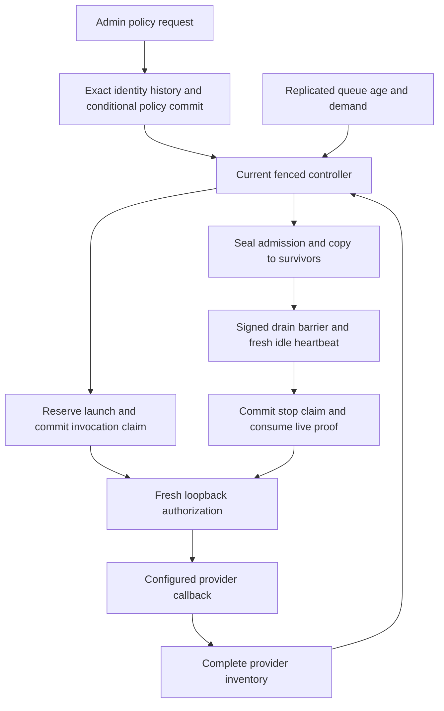

Configured provisioning uses the same worker queue as a fixed cluster. A controller must own its storage lease and catalog fence before it reserves a launch. Each callback command has immutable bytes, a retained invocation claim and a separate loopback authorization check immediately before the bridge calls the provider.



## Configure a Kubernetes provider

[Install the matching Python CLI and OLAP server](/guides/installation#install-the-cli-and-server-together) and activate the `.nabedra` environment. [Generate an OLAP cluster configuration](/server/clusters#initialize-and-supervise-shared-compute) with `nabedra database init` and adapt it for Kubernetes.

- Set `bind` to a reachable listener address. Set `advertise_url` and `api_urls` to HTTPS addresses the worker Pods can reach.
- Set `worker.listen` to a nonzero Pod-reachable port such as `0.0.0.0:8001`.
- Set `tls.cert_file`, `tls.key_file`, and `tls.ca_file` to the certificate, private key, and trusted CA. Make the corresponding TLS material available to worker Pods and use certificates valid for the advertised addresses.

Export `NABEDRA_CONFIG` with the config path and use its `cluster_id` in the example. Run it with the activated environment's Python. The public `serve()` entry point accepts synchronous callbacks.

```python
from pathlib import Path
from nabedra import KubernetesProvider, serve

provider = KubernetesProvider(
    api_url="https://kubernetes.example:6443",
    token=Path("/run/secrets/kubernetes-token").read_text().strip(),
    ca_file="/run/secrets/kubernetes-ca.pem",
    namespace="nabedra-workers",
    cluster_id="12345678-1234-4234-8234-123456789abc",
    image="registry.example/nabedra-worker:tested-version",
    pod_spec={
        "serviceAccountName": "nabedra-worker",
        "volumes": [{"name": "credentials", "secret": {"secretName": "nabedra-storage-auth"}}],
    },
    volume_mounts=[{"name": "credentials", "mountPath": "/run/nabedra-auth", "readOnly": True}],
)
serve(
    "Production",
    nodes=(1, 4),
    start_node=provider.start_node,
    stop_node=provider.stop_node,
    list_nodes=provider.list_nodes,
)
```

`NABEDRA_SERVER_BINARY` can name a separately built executable. The worker image needs `python3` and `nabedra-db` on `PATH`. The adapter mounts a bootstrap Secret read-only and uses the Pod IP from Kubernetes' downward API to produce the worker's advertised address. Object-store URLs must also be reachable from Pods. Token and TLS file paths in the worker template must exist in the image or configured Pod mounts. The adapter reserves its worker container and bootstrap volume. Additional credential volumes and mounts are explicit constructor inputs.

## Set the scaling policy

`nodes=3` maintains three provider workers. `nodes=(1, 4)` allows a desired count between those bounds. Sustained outstanding request age raises desired capacity by one; an empty queue must remain idle for the configured stabilization interval before it lowers desired capacity by one. Cooldown and provider failure backoff suppress repeated actions. Queue age is conservatively measured from the current queue holder's first observation, so recovery can delay a scale-up. Explicit fixed/manual operation has no callback bridge and rejects autoscaling without an adapter, preserving A01.

Scale-down that leaves workers running retains the scheduler and at least one ready holder. It seals admission during membership removal and re-establishes request copies on survivors before releasing the seal. It then waits for a signed worker drain barrier and a fresh authenticated heartbeat with no active or queued dependent work. Its stop invocation consumes that exact proof again at bridge authorization. Neither an HTTP delete acknowledgement nor an absent inventory record alone proves termination. A provider outage changes retry metadata and preserves accepted work. Autoscaling retains its final scheduler worker. An explicit `Cluster.scale(0)` waits for outstanding requests and coordination tasks to settle, seals admission, fences the final scheduler, and drains it before termination. Fresh provider evidence that every member stopped permits a new empty request run; a later `scale(1)` retains committed rows. A heartbeat timeout never authorizes that transition.

The Kubernetes adapter uses a deterministic Pod and Secret name for each launch UUID. It validates namespace, cluster, node and launch labels before removing anything. Deletion carries the recorded Pod UID as a precondition, so a replacement Pod cannot be removed under the previous resource identity. The adapter retains bootstrap Secrets and terminated UID evidence across API restarts; operators must manage their retention after removing corresponding control history. It does not automatically delete those Secrets. Kubernetes documents the [UID deletion precondition](https://kubernetes.io/docs/reference/kubernetes-api/definitions/preconditions-v1-meta/) and [Secret volume semantics](https://kubernetes.io/docs/concepts/configuration/secret/).

The adapter requires namespace-scoped permission to get/list/create/update Secrets and get/create/delete Pods. Resource configuration in bootstrap becomes the worker container's CPU and memory requests and limits. `resources.max_threads` is the compute ceiling; reported operation and partition coordination slots bound waiting work separately. Managed policy acceptance and worker admission validate that the coordinator's control reserve can support the requested compute frontier. Provisioning creates actual resources only when the user runs this configured path; importing the SDK has no provisioning side effects.

## Inspect cluster state

Cluster administration uses the separate admin credential:

```python
from nabedra import Cluster
cluster = Cluster("https://nabedra-api.example", admin_token)
status = cluster.status()
cluster.scale(3, wait=True)
cluster.autoscale(min_nodes=1, max_nodes=4)
```

The admin endpoint stores exact request identities and policy decisions through the existing conditional control history. Replaying the same identity and bytes returns its original policy acceptance; another body conflicts. Status reports fresh authenticated heartbeat age, validated resource ceilings and available capacity. Standalone local workers reject provisioning explicitly without accepting queued work.

To run the local provider tests, use the source archive and debug OLAP build from [local process acceptance](/server/clusters#local-process-acceptance). Run these commands from the extracted source directory.

```sh
PYTHONPATH=orm/python/src python3.11 -m unittest discover -s orm/python/tests -p test_providers.py
PYTHONPATH=orm/python/src python3.11 -m unittest discover -s orm/python/tests -p test_serve_public.py
python3.11 scripts/acceptance_providers.py --binary server/target/debug/nabedra-db
```

The process fixture exercises A01/A02 using real API and worker TCP processes and the configured callback bridge. It gates execution, raises capacity from one to two workers, injects an inventory failure, accepts new work while a proof-authorized stop waits, removes its worker, and checks all accepted identities and committed data. It also exercises the public admin policy/status API, request replay/conflict/authentication, explicit scale-to-zero and fresh-run restart, and a fixed/manual API that rejects autoscaling. The provider unit fixture separately exercises Kubernetes object versions, idempotent launch, lost creation replies, ownership mismatches, UID replacement and asynchronous deletion. These local assertions do not establish Kubernetes networking, RBAC, certificate mounting or lifecycle behavior in real infrastructure. The OLAP callback adapter in this guide covers Kubernetes. Experimental OLTP infrastructure adapters have their own [deployment guide](/operations/oltp-deployment).
